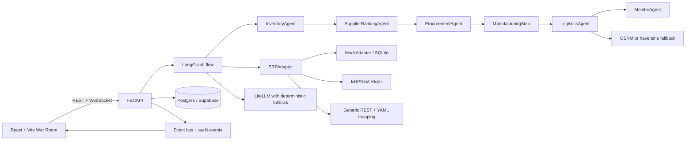

# Logistria

[](https://github.com/monish-19/logistria/actions/workflows/ci.yml)

Logistria is a deterministic operations control plane for supply-chain teams that
sits above an ERP/SCM. It checks inventory, ranks suppliers, gates procurement,
simulates manufacturing, optimizes delivery routes, and streams every decision
to the War Room UI.

## Project structure

- `backend/` - FastAPI API, agents, adapters, and database migrations
- `frontend/` - React + Vite War Room UI
- `scripts/` - operational and ERPNext seed scripts
- `docs/` - project briefs, phase summaries, demo scripts, and the legacy demo
- `.github/` - CI and repository instructions

## Architecture



Agents only depend on `ERPAdapter`; switching `ADAPTER` does not change the
pipeline. The default path is fully offline and does not require an LLM,
network access, or ERPNext.

## Setup

### Windows (PowerShell)

#### Local

```powershell
Copy-Item .env.example .env
python -m venv .venv
.\.venv\Scripts\Activate.ps1
python -m pip install -r backend\requirements.txt
Set-Location backend
python -c "from app.seed import seed_database; seed_database()"
$env:ALLOW_INSECURE_DEV = "true"
uvicorn app.main:app --reload
```

In a second terminal:

```powershell
Set-Location frontend
npm install
npm run dev
```

The API is available at <http://localhost:8000> and the War Room at
<http://localhost:5173>.

#### Docker

```powershell
Copy-Item .env.example .env
docker compose up --build
```

The default Compose profile uses the deterministic mock adapter. To start the
official ERPNext image with MariaDB and Redis:

```powershell
docker compose --profile erpnext up -d erpnext-db erpnext-redis-cache erpnext-redis-queue erpnext
$env:ERPNEXT_URL = "http://localhost:8080"
python scripts\erpnext_seed.py
```

Set `ADAPTER=erpnext` and `ERP_NEXT_BASE_URL=http://erpnext:8000` in the backend
environment when running the backend inside Compose. Keep
`ADAPTER_FALLBACK=true` for a deterministic local fallback if ERPNext is down.

#### Supabase

1. Create a Supabase project and copy its Session Pooler connection string.
2. Set `DATABASE_URL` to the `postgresql://...` URI with `sslmode=require`.
3. Apply the schema and seed the database:

```powershell
$env:DATABASE_URL = "postgresql://postgres.<project-ref>:<password>@<pooler-host>:5432/postgres?sslmode=require"
Set-Location backend
alembic upgrade head
python -c "from app.seed import seed_database; seed_database()"
uvicorn app.main:app --reload
```

### macOS / Linux (bash)

#### Local

```bash
cp .env.example .env
python3 -m venv .venv
source .venv/bin/activate
python3 -m pip install -r backend/requirements.txt
cd backend
python3 -c "from app.seed import seed_database; seed_database()"
export ALLOW_INSECURE_DEV=true
uvicorn app.main:app --reload
```

In a second terminal:

```bash
cd frontend
npm install
npm run dev
```

#### Docker

```bash
cp .env.example .env
docker compose up --build
```

To start the ERPNext profile and seed it:

```bash
docker compose --profile erpnext up -d erpnext-db erpnext-redis-cache erpnext-redis-queue erpnext
ERPNEXT_URL=http://localhost:8080 python3 scripts/erpnext_seed.py
```

#### Supabase

```bash
export DATABASE_URL='postgresql://postgres.<project-ref>:<password>@<pooler-host>:5432/postgres?sslmode=require'
cd backend
alembic upgrade head
python3 -c "from app.seed import seed_database; seed_database()"
export ALLOW_INSECURE_DEV=true
uvicorn app.main:app --reload
```

## Environment

| Variable | Default | Purpose |
| --- | --- | --- |
| `DATABASE_URL` | `sqlite:///./logistria.db` | SQLAlchemy database URL |
| `ADAPTER` | `mock` | `mock`, `erpnext`, or `generic` |
| `ADAPTER_FALLBACK` | `true` | Emit an alert and use MockAdapter when remote ERP calls fail |
| `ERP_NEXT_BASE_URL` | empty | ERPNext base URL used by the backend |
| `ERP_NEXT_API_KEY` / `ERP_NEXT_API_SECRET` | empty | ERPNext token credentials |
| `ERP_NEXT_TIMEOUT` | `10` | ERPNext request timeout in seconds |
| `GENERIC_BASE_URL` | empty | Generic REST ERP base URL |
| `GENERIC_ADAPTER_CONFIG` | empty | YAML endpoint mapping file |
| `ERPNEXT_URL` | `http://localhost:8080` | URL used by `scripts/erpnext_seed.py` |
| `ERPNEXT_API_KEY` / `ERPNEXT_API_SECRET` | empty | Seed script credentials |
| `LLM_PROVIDER` | `groq` | LiteLLM provider |
| `PRIMARY_MODEL` | `groq/openai/gpt-oss-120b` | Primary model |
| `NARRATOR_MODEL` | `groq/llama-3.1-8b-instant` | Event narration model |
| `FALLBACK_MODEL` | empty | Optional second model |
| `GROQ_API_KEY` | empty | Provider secret; never commit it |
| `AUTO_LIMIT` | `5000` | Maximum automatic purchase value |
| `ADMIN_API_KEY` | empty | Required key for protected API actions |
| `ALLOW_INSECURE_DEV` | `false` | Explicit local-only bypass for admin auth |
| `OSRM_URL` | OSRM public service | Routing service; empty uses haversine fallback |

## Demo script

Start the API with `ALLOW_INSECURE_DEV=true` for this local-only script. Every
request below is deterministic with the seeded MockAdapter.

### Windows (PowerShell)

### 1. Enough stock

```powershell
$body = '{"product_name":"Widget Pro","quantity":5,"due_date":"2035-01-20","urgency":"normal"}'
Invoke-RestMethod http://localhost:8000/api/runs -Method Post -ContentType 'application/json' -Body $body
```

Expected outcome: `status=manufacturing`, `approval_required=false`; the event
feed contains inventory approval, manufacturing progress, and a route.

### 2. Automatic purchase order

Use the seeded `Precision Gear` scenario: only Coating is short, and its one
eligible established supplier has enough history for high confidence.

```powershell
$body = '{"product_name":"Precision Gear","quantity":70,"due_date":"2035-01-20","urgency":"normal"}'
Invoke-RestMethod http://localhost:8000/api/runs -Method Post -ContentType 'application/json' -Body $body
```

Expected outcome: the ranking response has `confidence >= 0.80`,
`decision.status=auto_approved`, a purchase order event is emitted, and the run
continues to manufacturing without an approval row. In an ERPNext deployment,
ensure the seeded supplier/material records are present before running this
scenario.

### 3. Human review and resume

```powershell
$body = '{"product_name":"Sensor Module B3","quantity":50,"due_date":"2035-01-10","urgency":"high"}'
$pending = Invoke-RestMethod http://localhost:8000/api/runs -Method Post -ContentType 'application/json' -Body $body
$pending
$approval = '{"approved":true}'
Invoke-RestMethod "http://localhost:8000/api/runs/$($pending.run_id)/approve" -Method Post -ContentType 'application/json' -Body $approval
```

Expected outcome: the first response is `pending_human_review` with ranked
shortages; approval emits a human-action event and resumes manufacturing.

### Cold-start supplier win

The ranking contract is directly reproducible without network access:

```powershell
Set-Location backend
python -c "from tests.test_phase1 import test_cold_start_supplier_can_win_when_established_suppliers_are_poor; test_cold_start_supplier_can_win_when_established_suppliers_are_poor()"
```

Expected outcome: `NexGen Procure` is selected and the result contains
`cold_start=true`.

### Demand-spike chat

```powershell
$body = '{"message":"Demand for Product X will jump 40% next month"}'
$plan = Invoke-RestMethod http://localhost:8000/api/chat -Method Post -ContentType 'application/json' -Body $body
$plan
$confirm = @{
  plan_id = $plan.plan_id
  product_name = $plan.product_name
  quantity = $plan.recommended_quantity
  due_date = "2035-02-15"
  urgency = "high"
} | ConvertTo-Json
Invoke-RestMethod http://localhost:8000/api/chat/confirm -Method Post -ContentType 'application/json' -Body $confirm
```

Expected outcome: the first call returns a shortfall and
`requires_confirmation=true`; only the second call starts the production run.

### macOS / Linux (bash)

Start the API with `ALLOW_INSECURE_DEV=true` for this local-only script. Every
request below is deterministic with the seeded MockAdapter.

#### 1. Enough stock

```bash
curl -sS http://localhost:8000/api/runs \
  -H 'Content-Type: application/json' \
  -d '{"product_name":"Widget Pro","quantity":5,"due_date":"2035-01-20","urgency":"normal"}'
```

#### 2. Automatic purchase order

```bash
curl -sS http://localhost:8000/api/runs \
  -H 'Content-Type: application/json' \
  -d '{"product_name":"Precision Gear","quantity":70,"due_date":"2035-01-20","urgency":"normal"}'
```

#### 3. Human review and resume

```bash
pending=$(curl -sS http://localhost:8000/api/runs \
  -H 'Content-Type: application/json' \
  -d '{"product_name":"Sensor Module B3","quantity":50,"due_date":"2035-01-10","urgency":"high"}')
printf '%s\n' "$pending"
run_id=$(printf '%s' "$pending" | python3 -c 'import json,sys; print(json.load(sys.stdin)["run_id"])')
curl -sS "http://localhost:8000/api/runs/$run_id/approve" \
  -H 'Content-Type: application/json' \
  -d '{"approved":true}'
```

#### Cold-start supplier win

```bash
cd backend
python3 -c "from tests.test_phase1 import test_cold_start_supplier_can_win_when_established_suppliers_are_poor; test_cold_start_supplier_can_win_when_established_suppliers_are_poor()"
cd ..
```

#### Demand-spike chat

```bash
plan=$(curl -sS http://localhost:8000/api/chat \
  -H 'Content-Type: application/json' \
  -d '{"message":"Demand for Product X will jump 40% next month"}')
printf '%s\n' "$plan"
plan_id=$(printf '%s' "$plan" | python3 -c 'import json,sys; print(json.load(sys.stdin)["plan_id"])')
product_name=$(printf '%s' "$plan" | python3 -c 'import json,sys; print(json.load(sys.stdin)["product_name"])')
quantity=$(printf '%s' "$plan" | python3 -c 'import json,sys; print(json.load(sys.stdin)["recommended_quantity"])')
curl -sS http://localhost:8000/api/chat/confirm \
  -H 'Content-Type: application/json' \
  -d "{\"plan_id\":\"$plan_id\",\"product_name\":\"$product_name\",\"quantity\":$quantity,\"due_date\":\"2035-02-15\",\"urgency\":\"high\"}"
```

## Validation

```powershell
Set-Location backend
pytest -q
Set-Location ..\frontend
npm test
npm run build
```
